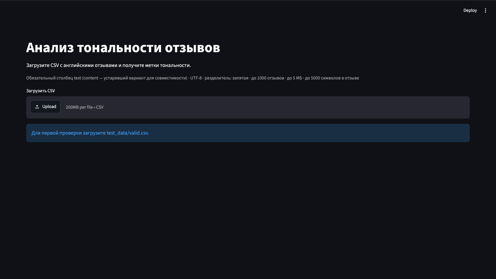
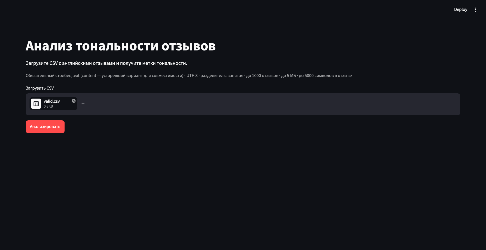
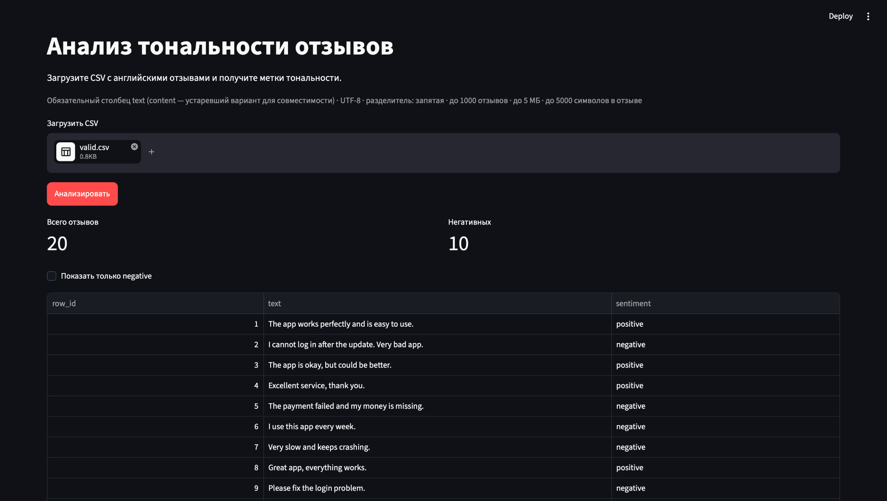
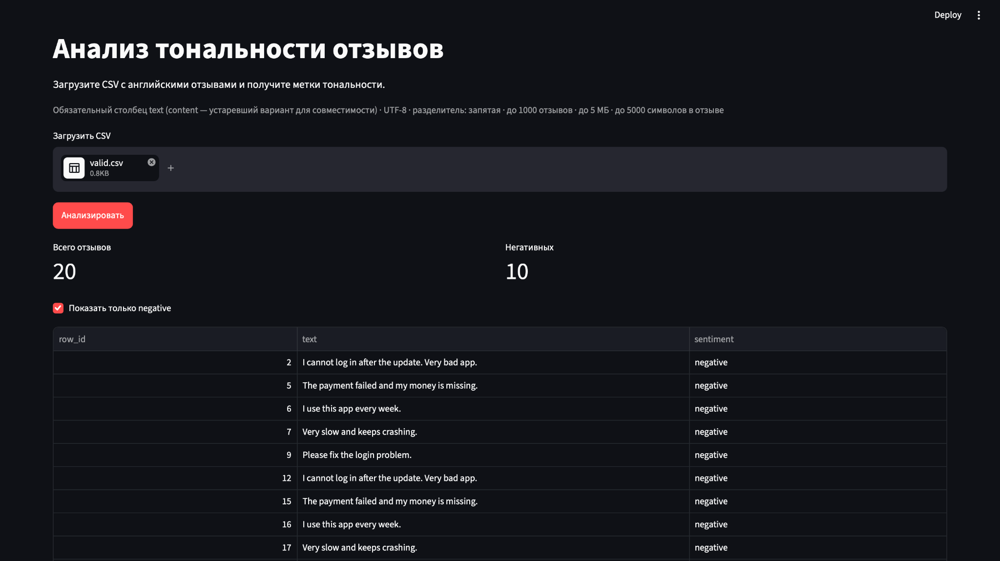
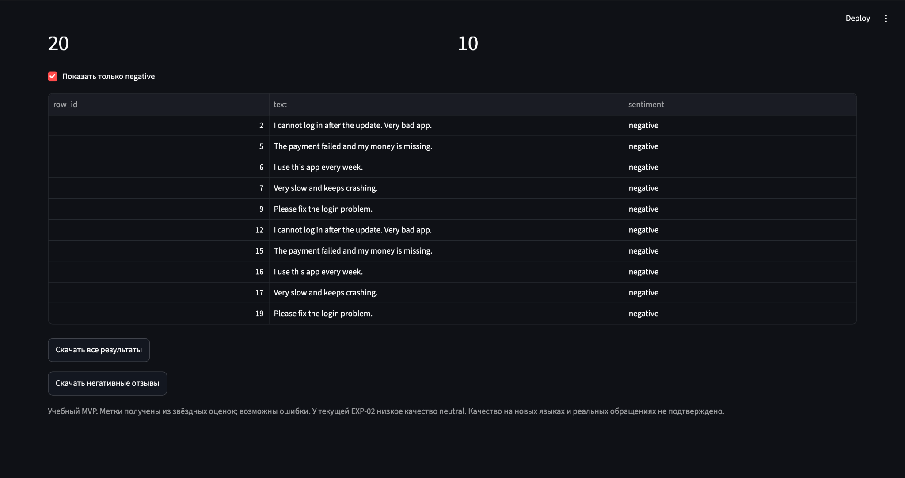
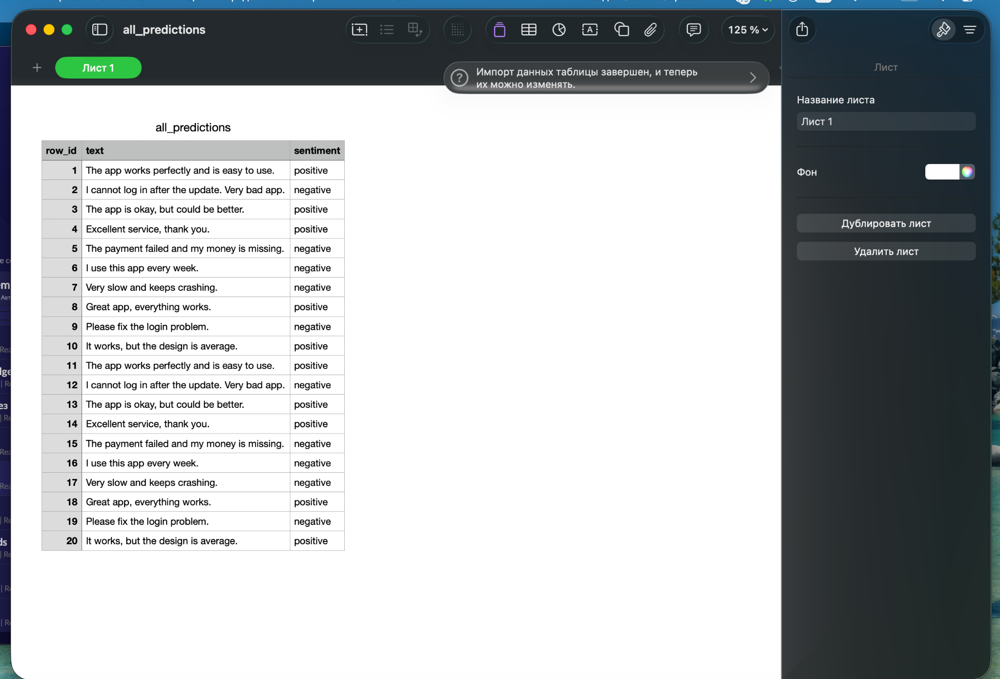

# Reviews-processing — анализ тональности отзывов

**Версия MVP: 0.1 (31.10.2026)** · **Интерфейс: Streamlit** · **Модель: TF-IDF + Logistic Regression**

Учебное локальное приложение для классификации англоязычных отзывов о телеком-сервисах. Пользователь загружает CSV, получает метки тональности (`negative`, `neutral`, `positive`), может показать только негативные отзывы и скачать результаты.

> Для работы приложения **не нужно обучать модель заново**: подготовленный pipeline хранится в `sentiment_model.joblib`.

## 1. Возможности MVP

- Загрузка CSV-файла с отзывами и проверка его формата.
- Присвоение каждому отзыву одной из трёх меток тональности.
- Отображение общего количества отзывов и количества записей с меткой `negative`.
- Просмотр общей таблицы и включение фильтра **«Показать только negative»**.
- Скачивание результатов: все отзывы или только негативные.
- Понятные сообщения об ошибках при некорректном входном файле.

## 2. Что находится в репозитории

| Файл / папка | Назначение |
| --- | --- |
| `app.py` | Streamlit-интерфейс |
| `core.py` | Проверка входного CSV и логика обработки |
| `sentiment_model.joblib` | Сохранённая обученная модель вместе с TF-IDF |
| `requirements.txt` | Зависимости Python |
| `baseline.ipynb` | Обучение модели и результаты экспериментов |
| `test_data/` | CSV-файлы для проверки обычных и ошибочных сценариев |
| `tests/` | Автоматические тесты |
| `demo_reviews.csv` | Дополнительный демонстрационный CSV |
| `images/` | Скриншоты интерфейса для этой инструкции |
| `QUICK_START.md` | Отдельное руководство по установке и запуску |

## 3. Установка и запуск

Пошаговая инструкция по подготовке окружения, установке зависимостей и запуску приложения на macOS и Windows вынесена в отдельный файл **[QUICK_START.md](QUICK_START.md)**.

Если проект уже установлен, откройте Quick Start и воспользуйтесь разделом «Запустить приложение».

## 4. Как пользоваться интерфейсом — инструкция со скриншотами

Ниже показан **реальный интерфейс MVP** при обработке `test_data/valid.csv`.

### Шаг 1. Открыть главный экран

На стартовом экране отображаются название сервиса, требования к CSV и поле **«Загрузить CSV»**.



### Шаг 2. Загрузить файл с отзывами

Нажмите **Upload** и выберите `test_data/valid.csv` из папки проекта. Название загруженного файла появится в области загрузки; ниже станет доступна кнопка **«Анализировать»**.



### Шаг 3. Выполнить анализ

Нажмите **«Анализировать»**. Приложение проверит CSV, применит обученную модель и покажет:

- **Всего отзывов** — количество обработанных строк;
- **Негативных** — количество строк с предсказанной меткой `negative`;
- таблицу `row_id`, `text`, `sentiment`.

В показанном запуске файла `test_data/valid.csv` обработано **20 отзывов**, из них **10 классифицированы как negative**. Это результат *данного демонстрационного файла*, а не универсальная характеристика модели.



### Шаг 4. Отфильтровать негативные отзывы

Поставьте галочку **«Показать только negative»**. В таблице останутся только строки с меткой `negative`. Снимите галочку, чтобы снова увидеть все результаты.



### Шаг 5. Скачать результаты

Ниже таблицы расположены две кнопки:

- **«Скачать все результаты»** — все обработанные отзывы и метки;
- **«Скачать негативные отзывы»** — только записи с меткой `negative`.

Если браузер запросит разрешение на скачивание файлов с `localhost`, разрешите загрузку. Название кнопки зависит от браузера.



### Шаг 6. Открыть выгруженный CSV

После скачивания можно открыть `all_predictions.csv` в программе для таблиц. В файле находятся столбцы:

| `row_id` | `text` | `sentiment` |
| --- | --- | --- |
| `1` | `The app works perfectly and is easy to use.` | `positive` |
| `2` | `I cannot log in after the update. Very bad app.` | `negative` |

Это фрагмент **фактического результата**, показанного на скриншоте, а не эталон качества классификации.



## 5. Входные данные и ограничения

Ожидается CSV с заголовками и следующими параметрами:

| Параметр | Требование |
| --- | --- |
| Кодировка | UTF-8 или UTF-8 BOM |
| Разделитель | Запятая |
| Основной столбец | `text` |
| Совместимость с baseline | Поддерживается `content`; если есть оба столбца, используется `text` |
| Число отзывов | От 1 до 1000 |
| Размер файла | Не более 5 000 000 байт |
| Длина одного отзыва | Не более 5000 символов после удаления пробелов по краям |
| Пустые отзывы | Не допускаются |

Пример `reviews.csv`:

```csv
text
The app works perfectly and is easy to use.
I cannot log in after the update. Very bad app.
The payment failed and my money is missing.
```

При выгрузке сохраняются порядок записей и исходный текст. Выходные поля: `row_id`, `text`, `sentiment`. Выгрузки создаются в UTF-8 BOM, чтобы их было удобно открывать в Excel. Если негативных отзывов нет, файл с негативными отзывами содержит заголовки и ноль строк.

> Надпись **«200MB per file»** у стандартного загрузчика Streamlit на скриншоте — это интерфейсное ограничение самого загрузчика. **Реальный лимит MVP — 5 МБ**, как указано выше.

## 6. Автоматические проверки

Из корневой папки проекта:

**macOS:**

```bash
.venv/bin/python -m unittest discover -s tests -v
```

**Windows:**

```powershell
.\.venv\Scripts\python.exe -m unittest discover -s tests -v
```

В исходной документации зафиксированы **14 автоматических проверок логики**. Материалы проверки в учебном комплекте: `../03_Evidence/core_test_evidence.txt` и `../03_Evidence/ui_smoke_evidence.txt`, если эта структура папок сохранена при передаче. UI-smoke проводился на временной тестовой модели; он не подтверждает качество ML-модели.

Пользовательские сценарии приёмки описаны в `../01_Documents/02_Test_Cases.docx`, а статус — в `../01_Documents/04_Test_Report.docx` (если документы передаются вместе с комплектом). Проверки на настоящей модели дополнительно описаны в файлах `test_real_model.py` и `06_Real_Model_Checks.json` в материалах команды.

По сообщению команды, **другой участник уже смог самостоятельно запустить приложение по README**. Этот факт подтверждает воспроизводимость запуска, но не заменяет полный Test Report.

## 7. ML-модель и известные ограничения

Модель — сохранённый pipeline **TF-IDF + Logistic Regression**. Она предсказывает `negative`, `neutral` или `positive`.

По сохранённым результатам baseline (эти показатели здесь не пересчитывались):

| Метрика | Значение |
| --- | ---: |
| Recall negative | 0.948 |
| Macro-F1 | 0.580 |
| Recall neutral | 0.014 |

- Критерий `Recall negative ≥ 0.85` оценивался отдельно на тестовой выборке, а не по 20 демонстрационным отзывам.
- **Класс `neutral` распознаётся плохо** — это известное ограничение проекта.
- Обучающие метки получены из звёздных оценок и могут содержать ошибки разметки.
- Данные обучения многоязычные; отдельное качество на английском сегменте не подтверждено.
- Модель предназначена для учебного MVP; пригодность к промышленному использованию и качество на новых реальных обращениях не подтверждены.

В материалах команды `EXPORT_CELL.txt` описывает пересчёт Recall negative, TP, FN, Macro-F1 и матрицы ошибок на `test_df`, с сохранением `ml_test_evidence.json`. Повторный анализ той же test-выборки не делает её новой независимой выборкой.

## 8. Если возникла проблема

| Проблема | Что проверить |
| --- | --- |
| `.venv/bin/python: no such file or directory` | Создайте окружение командой из шага 3.2 |
| `No module named ...` | Установите зависимости через Python из `.venv` |
| `sentiment_model.joblib` не найден | Убедитесь, что файл находится рядом с `app.py` |
| Ошибка чтения CSV | Проверьте UTF-8, запятую как разделитель и наличие заголовков |
| Нет `text` или `content` | Добавьте столбец `text` либо используйте поддерживаемый `content` |
| Файл превышает лимиты | Уменьшите файл до 5 МБ, не более 1000 строк и 5000 символов на отзыв |
| Страница не открывается | Проверьте, что Streamlit ещё работает, и откройте `Local URL` из терминала |
| Браузер не скачивает файл | Проверьте настройки скачивания; при запросе разрешите загрузки с `localhost` |
| Ошибка загрузки модели | Сверьте версии Python и библиотек с окружением, где модель была сохранена |
